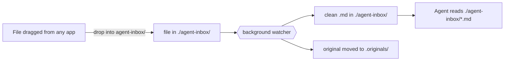

# Handoff: reading shared documents in this project

Paste this into the other project's agent session, or drop this file at that
project's root. It tells that agent what to do. It does not require running
anything inside the project.

## What this is

The user drops important documents (emails, Word docs, PDFs, and more) into
this project, converted to Markdown, so you, the project's coding agent, can use
them for strategy, decisions, and task tracking. You only ever read files. You do
not fetch anything or run any service.

## Where the files live

- `./agent-inbox/` at the project root. One Markdown file per document, named
  `YYYY-MM-DD--name.md`.
- If `./agent-inbox/` does not exist yet, create it. That empty folder is the target
  the user drags files onto.
- Originals are moved into `./agent-inbox/.originals/`. Ignore that folder. Do not
  read, edit, or delete anything in it.

## File format

Each file is YAML front matter followed by the converted content. Emails carry
subject/from/to/date; other documents carry title/source_file/type. Example email:

```
---
subject: "Re: Q3 migration go/no-go"
from: "Alice Vendor <alice@example.com>"
to: "You <you@example.com>"
cc: "Bob Lead <bob@example.com>"
date: "Mon, 17 Aug 2026 09:14:22 -0400"
message_id: "<...>"
attachments: ["plan.pdf"]
captured: "2026-08-17T13:14:30+00:00"
source: "drag-eml"
---

# Re: Q3 migration go/no-go

**From:** ...
**To:** ...
**Date:** ...

<full message body, including the quoted earlier thread>
```

## What to do with them

- Treat `./agent-inbox/` as primary source material from the user. When asked about
  project strategy, decisions, commitments, deadlines, or who agreed to what,
  read the relevant files there before answering.
- Pick up new files as they appear. The user adds files by dragging them in; you
  do not manage that.
- Only if the user asks, keep a short running summary of decisions and open
  action items pulled from these files (for example `agent-inbox/_summary.md`).

## What not to do

- Do not run a watcher, server, or setup from inside this project. Conversion
  happens outside, on the user's Mac.
- Do not modify or delete `./agent-inbox/.originals/`.
- Do not assume the set is complete. It holds only what the user chose to share.

## How a file gets here (for your understanding)

The user drags a file onto `./agent-inbox/` (an email `.eml`, a Word doc, a PDF, etc.).
A background watcher on the user's Mac converts each file into the Markdown you
read, then moves the original into `.originals/`.



## Setup note

Nothing to install in this project. The conversion is done by a separate,
machine-wide watcher the user runs. It only converts folders the user has
explicitly enabled. If this project's `agent-inbox/` folder is enabled, dropped files
become Markdown automatically; if not, they stay as they are until the user
enables it. Enabling folders is the user's job, not yours.
